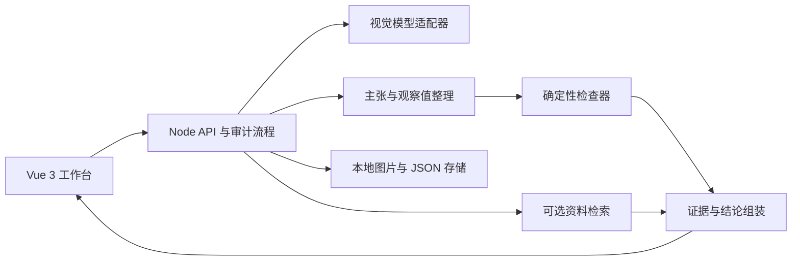

# 图证：图表证据审计台｜产品与实施计划 v0.2

> 状态：规划草案。产品名暂定。依据当前讨论与《AI-WEB网页开发挑战赛文档.md》制定；第一目标用户已由团队确认，其他用户需求与商业价值仍是待验证假设。

## 1. 一句话定义与成功标准

**图证帮助只有图表截图的人发现图内矛盾、理解可疑的呈现方式，并在获得更多证据后逐级核验结论。** 它展示每项判断所依据的图中文字、数值、公式和来源，也明确说明尚不能判断的部分。

第一目标用户确定为**没有原始数据文件的普通读者**；第二目标用户是发布图表前的内容编辑。竞赛演示使用团队自制图片和样例数据，云模型 API 是唯一必需的外部服务；不接入学校数据、账号或接口。

成功的最低标准：评委在 5–8 分钟内，能看见一张自制图表从「上传／选样例」到「发现问题、检查证据、手动确认、生成修正建议」的完整过程；对于缺少原始数据的图片，系统不会把图内检查冒充真实来源核验。

## 2. 从用户任务倒推产品

| 角色 | 手头有什么 | 真正要完成的事 | 当前阻碍 | 产品应给出的结果 |
| --- | --- | --- | --- | --- |
| 普通读者（第一用户） | 社交平台或文章中的图表截图 | 快速判断标题和图表是否自洽，知道还有什么不能确认 | 没有 CSV，不熟悉百分比和图表惯例 | 用白话说明疑点、显示图内证据、给出下一步要找的最少信息 |
| 内容编辑（第二用户） | 图表截图、文案，偶尔有数字表 | 发布前核稿并改正标题或图表 | 人工复核费时；数字口径和文案容易脱节 | 可追溯的核稿卡、修正预览和导出说明 |
| 审阅者（后续用户） | 他人导出的核稿卡 | 复查判断是否有依据 | AI 的一句话结论不可复核 | 看见公式、证据层级、未确认项和人工修改记录 |

核心场景：图表标出去年 80、今年 100，标题却写「增长 40%」。系统先给出「按图中数字计算为 25%，标题与图内数字不一致」。只有在用户提供可信的原始数据或可核查来源后，才进一步判断原始数据是否支持图表。

**从角色视角看一次使用：**读者刷到一张被大量转发的图，不会为弄懂它先去找原始 CSV；他想把截图放进网页，尽快看到「哪句话值得怀疑、为什么、我还缺什么」，并能将解释分享给朋友。编辑在发布前更在意另一件事：更正标题后能否留下可复核的记录，避免下次改图又把口径改错。因此默认入口保持极简，数据输入和核稿导出在需要时出现。

**价值假设：**普通读者获得可解释的媒介素养工具；内容团队减少发布错误。赛后可能尝试为编辑团队提供批量核稿或协作审阅，但比赛版本先验证「用户能否理解并信任证据等级」，不预设已有付费需求。

## 3. 产品边界与术语

**两条证据路径**

1. **图内检查**：仅有截图；检查可读标签、数值、标题、正文之间的关系，以及可能引起误读的呈现方式。结论只能是「与图内信息一致／矛盾／无法判断」。
2. **来源核验**：另有用户手填数值、原始 CSV 或公开数据来源；核对图表与这些材料是否一致，并明确来源类别。用户手填数据只算「用户确认」，不自动等同独立可信来源。

**审计对象**

- **图表资料**：上传的图片、粘贴的正文，以及后续可选的数据表或指标说明。
- **观察值**：模型从图片读出的原始文字、数值、坐标轴和单位；未经确认时始终标记为「模型提取」。
- **主张**：标题或正文中的可核查说法，例如「增长 40%」。
- **证据**：图片中的可定位区域、确认过的数字、数据表行列或附带来源的指标说明。
- **检查结果**：所用规则或计算、支持或矛盾的证据、证据等级、不确定原因和修正建议。

「视觉误导风险」与「事实矛盾」分开显示。例如柱状图从 95 开始纵轴，可能放大视觉差异，但仅凭这一点不能认定作者造假；折线图的非零起点也不能一律判错。

## 4. 体验骨架

### 第一入口：快速图表体检

1. 用户选择内置样例或上传一张带清晰文字、数字标签的柱状图／折线图。
2. 用户可裁剪图表区域；系统读取标题、标注、数值、单位，并展示提取结果供确认。看不清的数字不能默默补齐。
3. 系统列出主张卡：**图内一致、图内矛盾、需要确认、可能误读**。点击卡片可查看图片中的相应内容、计算式和解释。
4. 用户更正识别值或补充一个关键数字，卡片重新计算，变化可见。

### 第二入口：发布前核稿（第一版后加入）

用户再粘贴正文、手填数值或上传 CSV。系统对齐「标题—图表—正文—来源」，给出可导出的核稿卡。多张图片时，先核对指标、时间、单位和范围，再提示跨图冲突；匹配有歧义时要求用户确认。

### 关键页面

- **样例与上传页**：三个一键可运行案例；展示图片与数据如何处理。
- **审计工作台**：左侧原图和用户裁剪区域，右侧观察值、主张卡和证据详情。
- **修正对照页**：对确认过的数字展示修正标题；可对柱状图展示从零起点的对照视图。
- **导出页**：保存问题、公式、证据等级和未解决问题；不把模型建议写成事实结论。

## 5. 能力优先级

| 层级 | 必须交付的用户行为 | 对应的技术或创新点 | 明确边界 |
| --- | --- | --- | --- |
| **核心 MVP** | 一张图片 → 提取并确认 → 核算一个增长率／占比 → 展示证据卡 → 修正文案 | 多模态理解、结构化提取、确定性计算、证据分级 | 只支持文字和数字清楚的柱状／折线图；无来源不判断真实世界真伪 |
| **参赛完整版本** | 两图／图文一致性检查；柱状图坐标轴风险与公平对照；可选来源核验；导出 | 有界 Agent 工作流、工具调用、资料检索、可解释交互 | 跨图比较须先确认口径；资料检索只对有来源的问题运行 |
| **赛后扩展** | PDF 批量检查、公开数据源连接、协作审阅、浏览器扩展、更多图形和语言 | 输入适配器、检查规则与来源连接器扩展 | 不进入首轮排期；避免为扩展预先搭建复杂基础设施 |

参赛版本的 RAG 只用于**有真实指标定义或方法说明的案例**：预置少量许可明确的公开资料及其来源，检索后展示命中的原句；建立固定问题集比较「使用检索」与「未使用检索」的解释质量。普通截图没有相关资料时，不为了凑功能硬套 RAG。

## 6. 技术大框架：先小闭环，接口留余地

- **前端**：Vue 3、Vite、TypeScript；用组件呈现上传、观察值确认、主张卡、对照图和导出。无需 SSR，首版不使用 Nuxt。
- **服务端**：Node.js、Express、TypeScript；只在服务端读取 API 密钥并调用云端模型。开发脚本同时启动前后端；Windows 下首次 `npm install`，之后 `npm run dev`。
- **数据**：本地图片和 JSON；样例指标说明可按段落建立本地向量索引。首版没有数据库进程、Docker、WSL 或本地 GPU 要求。
- **稳定接口**：`输入解析`、`模型适配`、`证据检索`、`检查规则`、`结果组装`、`导出` 六处独立。未来加入 CSV、PDF、其他云模型或 MCP 工具时替换相应模块，审计结果的证据语义保持一致。
- **AI 工作流**：单个有界编排器决定下一步要确认、计算还是检索；工具只读或执行预定义算式，不能运行模型生成的任意代码。保留调用轨迹供演示和排错。无需堆叠多个虚设 Agent。

模型负责读图、匹配语义、解释歧义；百分比、差值、单位换算等由程序计算。模型输出先经结构校验和用户确认，再参与判定。

## 7. 分阶段实施与验收

以 [分阶段路线图](docs/PHASES.md) 为阶段、日期与验收状态的唯一记录；[阶段一任务](docs/STAGE-1.md)定义第一条可运行闭环。优先顺序是：**可靠的单图核验 > 可复查证据 > 两图一致性 > 视觉对照 > 批量与协作**。

## 8. 竞赛展示如何证明价值

| 评审重点 | 可展示的具体证据 |
| --- | --- |
| 大模型集成与多模态 | 同一张图的原图、提取出的结构化观察值、人工更正记录；展示模型识别错时系统如何恢复 |
| Agent／工作流与工具 | 「读图 → 判断还缺什么 → 请求确认／调用计算器 → 组装证据」的调用轨迹；工具使用有上限且可回放 |
| RAG | 只在带有公开指标定义的样例中显示检索片段、版本和引用；给出有无检索的同题结果对照 |
| 安全可控 | 无原始来源时仅作图内结论；看不清、口径不一致和无法核验时明确降级，不输出伪确定判断 |
| 选题、方案与交互创新 | 普通读者无需数据文件即可开始；证据逐级升级；跨图冲突和坐标轴对照可直接在界面操作 |
| 实用性、体验与社会价值 | 读者能解释一个有问题的图表，而不仅得到「AI 说它错了」；一键样例、加载进度和复核卡降低门槛 |

**演示脚本（5–8 分钟）：**先用 `80、100、40%` 案例建立核心闭环；再上传两张相同指标却标不同值的图片，展示口径确认；然后看柱状图纵轴风险和修正对照；最后打开有真实指标定义的样例，展示资料检索与引用。用一个模糊图展示系统会主动停下请用户确认。每一步都让评委看见输入、依据和结果变化，不把架构图当成实际能力。

## 9. 验证标准与风险控制

- 预先制作至少 18 个团队自有样例，覆盖算术矛盾、正确图、跨图冲突、视觉风险、模糊标签和缺失来源。评估的是用户看到的判断、引用与不确定性，不只测模型是否返回 JSON。
- 对已由用户确认的数值，增长率和占比计算必须与确定性参考结果一致。对看不清的数字、缺少来源的真伪问题，系统必须要求确认或降级结论。
- 跨图检查必须同时核对指标、时间、单位和人群／范围；只要任一要素不清楚，显示「待核对」而不是冲突定论。
- 固定一小组方法说明问题，记录检索命中片段与最终引用是否支持回答；若 RAG 无明显增益，就缩小语料和改进检索，不把“接了向量库”当成果。
- 图片默认只保存在本机演示环境；上传大小和格式受限，提供删除操作。外部模型处理和结果不确定性在界面说明。API 密钥只放服务端环境变量。

## 10. 两人分工与接口

- **成员 A（产品与前端主责）**：场景样例、交互原型、Vue 工作台、证据卡与对照图、视频叙事。
- **成员 B（AI 与服务端主责）**：模型调用与结构校验、计算工具、可选检索、本地存储、调用轨迹。
- **共同验收**：先约定观察值和检查结果的数据结构；每个阶段都由另一人使用预置样例走完整流程并记录误判。前后端以结果结构为交接面，不按页面与 API 各自孤立开发。

## 11. 当前尚未锁死的决定

1. **云模型供应商**：在可行性闸门用同一组截图验证视觉提取、结构化输出、成本与延迟后确定；避免先绑定模型名。
2. **资料来源**：参赛完整版本只选择可公开使用、可标注出处的少量指标说明；不依赖外部实时接口。若找不到与样例真正相关的资料，调整样例而非伪造引用。
3. **精确定位能力**：首版通过用户裁剪和文本引用定位；自动图像坐标框选只有在验证稳定后才加入。

后续把本计划细化为产品规格与垂直切片任务：每一片都必须从用户输入贯通到可验证的界面结果。
