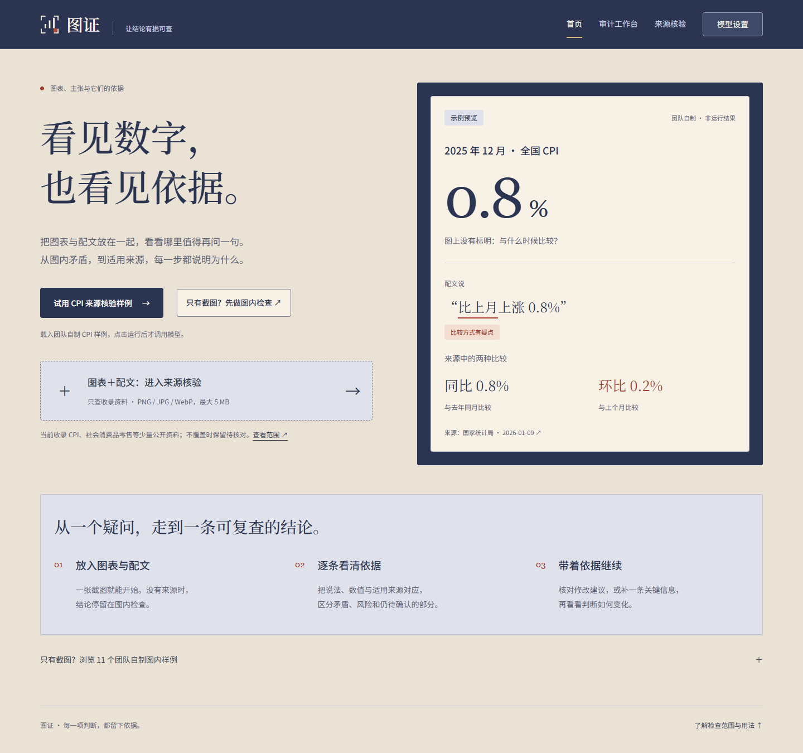

# 图证 · 让结论有据可查

把一张图表截图和一段配文放在一起，检查数字是否自洽、推断缺什么依据，以及适用公开来源是否支持这些说法。

图证面向没有原始数据文件的普通读者，也可供内容编辑在发布前核稿。模型读取图表、拆解主张，程序计算数值、检索资料并校验引用，用户逐项确认后再采用修改建议。



首页为静态示意，不是模型运行结果。当前界面采用暖纸色与靛蓝，覆盖首页、图内工作台、来源核验和模型设置四个页面。

## 快速开始

Windows 开发环境使用 Node.js 24、npm 与系统 Edge。

```powershell
npm ci
npm run dev
```

打开 `http://127.0.0.1:5173`。API 默认监听 `127.0.0.1:3001`；端口被占用时明确报错。自定义端口、WebStorm、模型配置及验证方式见[开发与运行](docs/DEVELOPMENT.md)。

可以先使用团队自制样例，预置的图内观察不会调用模型。只有主动读取新图片、运行来源核验、提交补证或测试连接时，才会请求配置的上游服务。默认通过设置页保存本机配置；如何启用环境配置、选择协议及保护密钥，见[模型配置](docs/MODEL-CONFIG.md)。

## 可以做什么

| 用户任务 | 路径与结果 |
| --- | --- |
| 只有截图，先核对数字 | `/audit`：模型提取 → 人工确认/更正 → 程序计算 → 图内结论、公式与证据摘录 |
| 一张图里有多条说法 | 主张独立确认、重算、会话记录和重置；缺少可复查依据时保留待核对 |
| 比较两张图或检查视觉呈现 | 核对时间、单位和范围，再比较数字；柱状图可查看纵轴风险与零起点对照 |
| 核对图表和配文的来源 | `/source-audit`：主张拆解、固定公开资料库检索、口径对照、引用与真实工具轨迹 |
| 修改一段配文 | 逐处查看建议、理由和引用，主动采用；输入改变后旧结论进入历史，需重新核验 |

图中的数字相互一致，不能证明原始数据真实。来源核验只覆盖当前收录的资料，检索命中的材料还要核对是否适用。必要补证能力已实现，但是否追问取决于实际运行；新版视频中的缺口径案例仍为待核对，没有触发追问或恢复调查。

## 演示与提交材料

| 材料 | 当前入口 |
| --- | --- |
| 新版实机视频 | [6 分 38 秒有声 MP4](docs/submission/tuzheng-competition-demo-2026-10-28.mp4)，1080p / 30 fps；[技术检查](docs/evidence/final-video-2026-10-28/README.md)通过，用户已完整看听并确认可作为提交版 |
| 配音 | [九段时间轴与完整讲稿](docs/submission/demo-2026-10-18/voiceover.md)、[章节 SRT](docs/submission/demo-2026-10-18/chapters.srt) |
| 赛事技术文档 | [17 页 PDF](docs/submission/web-match-competition-report.pdf)、[HTML 源](docs/submission/competition-report.html)，已补充当前交付状态 |
| 当前材料和人工待办 | [提交材料索引](docs/submission/README.md)、[交付包与第二环境回执](docs/submission/closeout/README.md) |
| 预指导提交 | [4页作品介绍](docs/submission/tuzheng-project-introduction.pdf)、[两入口要求与操作指南](docs/submission/pre-guidance-submit-guide.md)；预指导截止10月31日15:00，正式省赛仍需另行提交 |

2026-10-18 实录使用当前生产页面和 DeepSeek 官方真实请求：7 次模型 HTTP，用量完整。这段实录展示产品操作；模型效果评测、CI、人工验收和真实读者收益另有各自的记录，见[证据索引](docs/evidence/README.md)。

2026-10-23 已补入团队资料，并按用户授权将 [GitHub 仓库](https://github.com/Iskuyal/tuzheng)设为 PUBLIC；当时仓库和材料的[匿名访问检查](docs/evidence/non-video-closeout-2026-10-23/anonymous-access.json)通过。2026-10-28 用户提供有声视频，并确认第二台 Windows 已由另一位开发者验收，见[交付更新](docs/submission/closeout/delivery-update-2026-10-28.json)；该机器原始报告未提供。旧请求已按用户决定停止核账，负责人抽查和赛事作品提交仍待完成。

## 开发与检查

前端为 Vue 3 / Vue Router / Vite / TypeScript，Node + Express 负责模型适配与核验，`shared/` 保存领域类型和确定性规则。本机 API 仅监听回环地址；不需要数据库进程或本地 GPU。

```powershell
npm run docs:check
npm run verify:materials
npm test
npm run build
npm run test:e2e
```

以上命令运行离线检查。配置矩阵、固定样例、受控在线评测及 CI 的验证范围，见[开发指南](docs/DEVELOPMENT.md)和[脚本导航](scripts/README.md)。付费评测需另行授权，不能由日常验证命令意外触发。

## 文档与团队

- [文档导航](docs/README.md)：按运行、结构、材料与证据查阅。
- [当前路线图](docs/PHASES.md)：阶段状态与最近实测；[历史记录](docs/history/PHASES-2026-10-18.md)保留旧轮次。
- [产品蓝图](PLAN.md)、[领域术语](CONTEXT.md)、[项目结构](docs/STRUCTURE.md)。

团队名称：**岭南凤翔团队**。以下信息由用户于 2026-10-23 提供；用户随后确认已报名缴费、联系人已核对，见[确认记录](docs/submission/closeout/progress-2026-10-23.json)。该记录是用户确认，尚无赛事作品提交回执；未推定两位成员的个人分工。

| 成员 | 学校 | 报名组别 |
| --- | --- | --- |
| 梁钦健 | 岭南职业技术学院（清远校区） | C组 |
| 梁智量 | 岭南职业技术学院（清远校区） | C组 |

项目问题与反馈可提交到[仓库 Issues](https://github.com/Iskuyal/tuzheng/issues)。个人电话和邮箱尚未提供，材料中不代填。

技术标识和仓库名为 `tuzheng`。旧材料文件名中的 `web-match` 为历史标识，保留路径供追溯。
